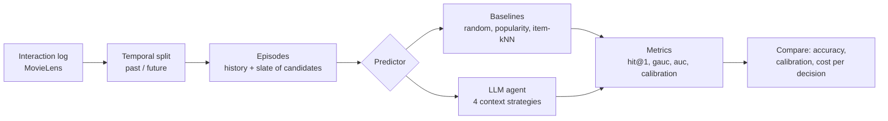

# user-simulation

An experiment in building an LLM agent that simulates a user's decision — e.g. *given
everything this user has done up until now, will they click/watch this movie?* — and
measuring whether it actually predicts real behavior better than classic recommenders.

## Workflow



1. **Load** a real interaction log (who watched what, and when).
2. **Split** it at a point in time: the past is what the simulator may learn from, the
   future is what it has to predict.
3. **Build episodes**: each future interaction becomes a decision — the user's history up
   to that moment plus a slate of movies, one of which they actually chose.
4. **Predict**: every simulator scores the same slates through one shared interface, from
   simple baselines to the LLM agent.
5. **Score** the predictions against what users really did, and compare simulators on
   accuracy, calibration and cost.

## Framing

Every simulator answers the same question on the same **episodes**:

- A global time **cutoff** splits the log. Global statistics (popularity, item
  similarity) are learned only from interactions before it.
- Each post-cutoff interaction becomes an episode: the user is shown a **slate** of
  candidates, one of which they actually chose, plus sampled negatives.
- The simulator sees the user's own history strictly before the episode, then scores
  every candidate.

Negatives are sampled only from items that already existed at decision time and that the
user never rated. By default (`matched`) they come from films released in the **same year**
as the real choice, weighted by how often each was rated in the last 100,000 ratings
before the decision. Year matching matters: episodes are a returning user's first ratings
after the cutoff, and those are mostly new releases (45% of choices on validation are
1999–2000 films vs 14% of popularity-weighted negatives). Without it, "pick the newest
film on the slate" scores hit@1 ≈ 0.46. `popularity` (pre-cutoff counts) and `uniform`
are kept for comparison.

Metrics: `hit@1` (did the top pick match the real choice), `mrr`, `ndcg`, `gauc`
(per-slate AUC), pooled `auc`; plus `log_loss` and `ece` for predictors that output
probabilities. Ties count as their random-ordering expectation, so constant scores give
chance-level numbers.

`hit@1` and `gauc` come with 95% bootstrap intervals, plus a paired difference against the
popularity baseline on the same episodes. The bootstrap resamples whole users, since one
user's slates are not independent; random vs random with another seed comes out as no
difference.

## Usage

```bash
uv sync
uv run user-sim eval                                    # validation split: ml-1m, slate of 5, matched negatives
uv run user-sim eval --split test                       # test split: only for reporting final numbers
uv run user-sim eval --negatives uniform --slate-size 10
uv run pytest
```

The LLM agent runs offline: `llm-export` writes prompts for a fixed subset of episodes
(one per user, no labels) to `data/llm/<split>-<negatives>-<context>/prompts-NN.md`; the
LLM answers each batch in a `responses-NN.json` mapping prompt key to `{"A": p, ...}`;
`llm-eval` scores those answers next to the baselines on the same subset.

`--context` picks what the prompt shows about the user: `recent` (last `--n-recent`
ratings, default 20), `full` (every rating), `memo` (a profile of at most 120 words) or
`memo-tools` (the profile plus lookup tools). For the memo contexts, the first
`llm-export` writes memo prompts (history only, no slate) to
`data/llm/<split>-<negatives>-memo/memo-prompts-NN.md`. They are answered in
`memos-NN.json`, and a second `llm-export` then writes the decision prompts. Tools are
answered by `python -m user_simulation.tools`, from per-episode data written at export
time, and every call is logged so its output counts towards tokens.

```bash
uv run user-sim llm-export --split test --context full     # 300 episodes
uv run user-sim llm-eval --split test --context recent full memo memo-tools --reference llm_recent
```

Each answer is keyed by a hash of the episode and the exact prompt, so editing the prompt
invalidates old answers. Users listed in `<run dir>/excluded_users.txt` are dropped from
the subset (see the step-4 notes below).

Datasets download to `data/raw/` on first use (git-ignored).

## Baselines (ml-1m test split, default settings, seed 0)

4,874 episodes from 1,044 users; cutoff 2000-12-02.

| negatives  | predictor      | hit@1 | gauc  | auc   |
|------------|----------------|-------|-------|-------|
| matched    | random         | 0.187 | 0.493 | 0.489 |
| matched    | popularity     | 0.384 | 0.644 | 0.633 |
| matched    | newest_release | 0.199 | 0.500 | 0.500 |
| matched    | item_knn       | 0.399 | 0.659 | 0.620 |
| popularity | random         | 0.201 | 0.500 | 0.499 |
| popularity | popularity     | 0.293 | 0.565 | 0.564 |
| popularity | newest_release | 0.456 | 0.659 | 0.659 |
| popularity | item_knn       | 0.298 | 0.561 | 0.549 |
| uniform    | random         | 0.199 | 0.498 | 0.498 |
| uniform    | popularity     | 0.620 | 0.835 | 0.832 |
| uniform    | newest_release | 0.440 | 0.642 | 0.642 |
| uniform    | item_knn       | 0.580 | 0.815 | 0.795 |

Observations so far:

- Item-kNN uses the user's last 10 items, picked on validation (matched negatives; the
  same value also won under popularity negatives):

  | max_history | 10    | 20    | 50    | 100   |
  |-------------|-------|-------|-------|-------|
  | hit@1       | 0.389 | 0.377 | 0.372 | 0.367 |
  | gauc        | 0.647 | 0.635 | 0.630 | 0.627 |

- Recency dominates: the median gap between an episode and the user's previous
  interaction is 0 days, and kNN gets worse with every extra slice of history. That's a
  context-engineering result before any LLM is involved: more history is not more signal.
- `newest_release` (score = release year) is the check that the benchmark doesn't leak
  release recency: it is at chance with matched negatives and the best baseline without.
- `ml-latest-small` yields only ~130 episodes under a global cutoff (most users rate in
  a single burst), so it's for smoke tests only.

## LLM agent, first run (step 4, test split, popularity negatives)

Claude (Opus 5.5, in a Claude Code session, no API) answered all 293 prompts of the test
subset: the user's last 20 ratings (title, year, genres, stars) and the 5-movie slate.
One fixed prompt, not tuned; 0 unparsed answers; ~421 prompt tokens per decision.

| predictor      | hit@1 [95% CI]        | gauc [95% CI]         | log_loss | ece   |
|----------------|-----------------------|-----------------------|----------|-------|
| random         | 0.235 [0.188, 0.283]  | 0.515 [0.474, 0.558]  |          |       |
| popularity     | 0.280 [0.229, 0.331]  | 0.565 [0.523, 0.610]  |          |       |
| item_knn       | 0.287 [0.232, 0.338]  | 0.540 [0.497, 0.584]  |          |       |
| newest_release | 0.487 [0.432, 0.544]  | 0.683 [0.639, 0.726]  |          |       |
| llm_agent      | 0.489 [0.435, 0.544]  | 0.733 [0.698, 0.767]  | 0.446    | 0.068 |

This run used the old popularity negatives and is what exposed the leak; the
step-5 runs below use matched negatives. Paired against `newest_release`: hit@1 +0.001 [−0.066, +0.073], gauc +0.049
[0.000, +0.102]. The agent beats popularity and kNN by ~0.2 hit@1, but almost all of
that is the release-recency leak above; on ranking the full slate it is at best slightly
better. A constant 0.2 would score log-loss 0.500, so its probabilities carry some signal
and are reasonably calibrated.

How the subset was built, and what it excludes:

- One episode per user. A user's later prompt contains their earlier answer in its
  history, so two episodes of the same user side by side leak it.
- 7 users (`excluded_users.txt` in that run directory) were dropped because their later
  prompts had already been read while an earlier, leaky export was being answered.
- Same model answering as wrote the code: it saw only aggregate baseline numbers on test
  before answering, never per-episode labels.

## Context-engineering ablation (step 5, test split, matched negatives)

The agent is the same throughout, and so are the 300 test episodes (one per user) and the
instructions; only what it is shown about the user changes. Each strategy was answered by
fresh Claude (Opus 5.5) subagents. They were told to read only their batch files and,
for `memo-tools`, to run only the lookup command. They never saw labels, other
strategies' prompts or answers. Every strategy got 0 unparsed answers.

| predictor      | hit@1 [95% CI]       | gauc [95% CI]        | log_loss | ece   | tokens / decision | incl. memo |
|----------------|----------------------|----------------------|----------|-------|-------------------|------------|
| random         | 0.207 [0.160, 0.253] | 0.488 [0.449, 0.528] |          |       |                   |            |
| newest_release | 0.200                | 0.500                |          |       |                   |            |
| popularity     | 0.370 [0.317, 0.423] | 0.629 [0.590, 0.671] |          |       |                   |            |
| item_knn       | 0.410 [0.353, 0.467] | 0.652 [0.612, 0.693] |          |       |                   |            |
| llm_recent     | 0.451 [0.400, 0.504] | 0.706 [0.669, 0.742] | 0.454    | 0.052 | ~419              |            |
| llm_full       | 0.513 [0.460, 0.567] | 0.758 [0.723, 0.790] | 0.425    | 0.061 | ~3,002            |            |
| llm_memo       | 0.487 [0.431, 0.541] | 0.738 [0.704, 0.772] | 0.423    | 0.046 | ~351              | ~3,448     |
| llm_memo-tools | 0.474 [0.419, 0.526] | 0.737 [0.700, 0.771] | 0.440    | 0.060 | ~617              | ~3,714     |

Paired differences (bootstrap over users, * = interval excludes 0):

| comparison              | hit@1                     | gauc                      |
|-------------------------|---------------------------|---------------------------|
| recent − popularity     | +0.081 [+0.023, +0.137] * | +0.077 [+0.037, +0.115] * |
| recent − item_knn       | +0.041 [−0.014, +0.094]   | +0.054 [+0.020, +0.087] * |
| full − recent           | +0.063 [+0.022, +0.106] * | +0.052 [+0.028, +0.077] * |
| memo − recent           | +0.037 [−0.006, +0.079]   | +0.033 [+0.006, +0.059] * |
| memo-tools − recent     | +0.023 [−0.017, +0.062]   | +0.031 [+0.007, +0.056] * |
| full − memo             | +0.026 [−0.014, +0.068]   | +0.020 [−0.002, +0.042]   |
| full − memo-tools       | +0.039 [+0.001, +0.081] * | +0.021 [+0.001, +0.043] * |
| memo-tools − memo       | −0.013 [−0.046, +0.019]   | −0.002 [−0.020, +0.016]   |

What it shows:

- Once release recency is matched away, every LLM context beats popularity, and on gauc
  it beats item-kNN too. The 20-rating prompt alone is +0.08 hit@1 over popularity.
- Unlike kNN, the LLM gains from more history. The full history is the best strategy, by
  +0.06 hit@1 over the last 20 ratings, but it costs ~7× the tokens per decision.
- The memo keeps most of that gain at decision time: about 60% of the hit@1 gap between
  recent and full, and its gauc is within 0.02 of full. It is the cheapest prompt
  (~351 tokens) and the best calibrated (ece 0.046). Writing the memo reads the full
  history once, though, so the first decision costs about as much as `full`. The memo
  pays off only when it is reused across many decisions; here each user has one.
- Tools added nothing over the memo alone (−0.013 hit@1, interval spans 0) and nearly
  doubled decision tokens. The agents used them unevenly: 335 calls, on 141 of the 300
  episodes (233 `item_details`, 95 `recent_history`, 7 `similar_in_history`). By
  answering agent, 60 episodes each, against the memo-only answers on the same episodes:
  - the agent that looked up `item_details` on most slates, using pre-cutoff rating
    counts as a popularity cue: 0.483 vs 0.531 hit@1;
  - the agent that called `recent_history` on all 60 episodes: 0.517 vs 0.511;
  - the rest, with few lookups: within ±0.01.

  Popularity is a weak cue here because negatives are already drawn in proportion to
  recent popularity. The samples are small, but nothing suggests that tool access, as
  these agents used it, helps.

Caveats:

- Subagents were instructed, not sandboxed. Their reports say they followed the rules,
  apart from chaining several lookup commands into one shell call.
- Tokens are prompt characters / 4, plus tool output, not API usage. Reasoning tokens and
  answer tokens are not counted.
- Every strategy was answered by a different set of agents: fresh agents per strategy,
  2–5 per strategy. So part of a difference may be agent variance rather than context.
  The per-agent spread above (±0.05 hit@1 on 60 episodes) is of the same order as the
  gaps between strategies.
- 11 of the 300 memos run slightly over the 120-word limit (max 125 words).
- One model family wrote the code, the memos and the answers.

## Caveats

- MovieLens records *ratings*, not impressions. "Rated" stands in for "watched", and
  "never rated" stands in for "shown but skipped". Ratings also arrive in bulk sessions.
- Hyper-parameters must be chosen on the validation split (`--split validation`, the
  default), not on these episodes. Validation reruns the same split on the log before the
  test cutoff, with the last 14 days as its future: cutoff 2000-11-18, 656 episodes from
  174 users.

## Layout

```
src/user_simulation/
  data/        MovieLens loader, temporal split, episode + negative sampling
  baselines/   random, popularity, newest-release, item-kNN
  agent.py     offline LLM agent: context strategies, prompt export, answer cache, Predictor
  tools.py     lookup tools for the memo-tools context (per-episode data + CLI)
  eval/        metrics and the evaluate() runner
  predictor.py the Predictor protocol every simulator (incl. the LLM agent) implements
```
