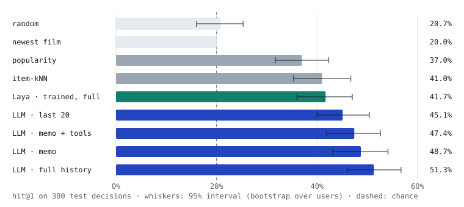
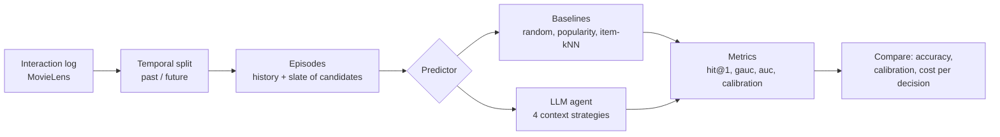

# user-simulation

An experiment in building an LLM agent that simulates a user's decision — e.g. *given
everything this user has done up until now, will they click/watch this movie?* — and
measuring whether it actually predicts real behavior better than classic recommenders.

## Results

The full write-up, in plain language with figures, is in [docs/report.md](docs/report.md).
Its summary:

1. **Our first test was broken, and the LLM exposed it.** A one-line rule, "pick the
   newest film", matched the LLM's score. We rebuilt the test so that rule scores no better
   than chance.
2. **On the fair test, the LLM beats classic recommenders.** It picks the right film
   45–51% of the time, against 37% for "pick the most popular" and 41% for a standard
   recommender. Guessing scores 20%.
3. **More history helps the LLM.** Reading a person's whole history beats reading their
   last 20 ratings. The classic recommender gets worse with more history.
4. **A 120-word profile keeps most of that gain** at about an eighth of the reading cost
   per decision. Giving the LLM lookup tools added nothing.



300 test decisions (one per user), matched negatives; LLM answers from Claude (Opus 5.5)
subagents, no API:

| predictor | hit@1 | gauc | log loss | ece | tokens / decision | incl. writing memo |
|---|---:|---:|---:|---:|---:|---:|
| random | 0.207 | 0.488 | | | | |
| newest film | 0.200 | 0.500 | | | | |
| popularity | 0.370 | 0.629 | | | | |
| item-kNN | 0.410 | 0.652 | | | | |
| LLM · last 20 | 0.451 | 0.706 | 0.454 | 0.052 | ~419 | |
| LLM · full history | **0.513** | **0.758** | 0.425 | 0.061 | ~3,002 | |
| LLM · memo | 0.487 | 0.738 | **0.423** | **0.046** | **~351** | ~3,448 |
| LLM · memo + tools | 0.474 | 0.737 | 0.440 | 0.060 | ~617 | ~3,714 |

Paired comparisons, the release-year leak we found and fixed, per-agent tool use and the limits are in the report.

## Workflow



1. **Load** a real interaction log (who watched what, and when).
2. **Split** it at a point in time: the past is what the simulator may learn from, the
   future is what it has to predict.
3. **Build episodes**: each future interaction becomes a decision — the user's history up
   to that moment plus a slate of movies, one of which they actually chose.
4. **Predict**: every simulator scores the same slates through one shared interface, from
   simple baselines to the LLM agent.
5. **Score** the predictions against what users really did, and compare simulators on
   accuracy, calibration and cost.

## Framing

Every simulator answers the same question on the same **episodes**:

- A global time **cutoff** splits the log. Global statistics (popularity, item
  similarity) are learned only from interactions before it.
- Each post-cutoff interaction becomes an episode: the user is shown a **slate** of
  candidates, one of which they actually chose, plus sampled negatives.
- The simulator sees the user's own history strictly before the episode, then scores
  every candidate.

Negatives are sampled only from items that already existed at decision time and that the
user never rated. By default (`matched`) they come from films released in the **same year**
as the real choice, weighted by how often each was rated in the last 100,000 ratings
before the decision. Year matching matters: episodes are a returning user's first ratings
after the cutoff, and those are mostly new releases (45% of choices on validation are
1999–2000 films vs 14% of popularity-weighted negatives). Without it, "pick the newest
film on the slate" scores hit@1 ≈ 0.46. `popularity` (pre-cutoff counts) and `uniform`
are kept for comparison.

Metrics: `hit@1` (did the top pick match the real choice), `mrr`, `ndcg`, `gauc`
(per-slate AUC), pooled `auc`; plus `log_loss` and `ece` for predictors that output
probabilities. Ties count as their random-ordering expectation, so constant scores give
chance-level numbers.

`hit@1` and `gauc` come with 95% bootstrap intervals, plus a paired difference against the
popularity baseline on the same episodes. The bootstrap resamples whole users, since one
user's slates are not independent; random vs random with another seed comes out as no
difference.

## Usage

```bash
uv sync
uv run user-sim eval                                    # validation split: ml-1m, slate of 5, matched negatives
uv run user-sim eval --split test                       # test split: only for reporting final numbers
uv run user-sim eval --negatives uniform --slate-size 10
uv run pytest
```

The LLM agent runs offline: `llm-export` writes prompts for a fixed subset of episodes
(one per user, no labels) to `data/llm/<split>-<negatives>-<context>/prompts-NN.md`; the
LLM answers each batch in a `responses-NN.json` mapping prompt key to `{"A": p, ...}`;
`llm-eval` scores those answers next to the baselines on the same subset.

`--context` picks what the prompt shows about the user: `recent` (last `--n-recent`
ratings, default 20), `full` (every rating), `memo` (a profile of at most 120 words) or
`memo-tools` (the profile plus lookup tools). For the memo contexts, the first
`llm-export` writes memo prompts (history only, no slate) to
`data/llm/<split>-<negatives>-memo/memo-prompts-NN.md`. They are answered in
`memos-NN.json`, and a second `llm-export` then writes the decision prompts. Tools are
answered by `python -m user_simulation.tools`, from per-episode data written at export
time, and every call is logged so its output counts towards tokens.

```bash
uv run user-sim llm-export --split test --context full     # 300 episodes
uv run user-sim llm-eval --split test --context recent full memo memo-tools --reference llm_recent
```

Each answer is keyed by a hash of the episode and the exact prompt, so editing the prompt
invalidates old answers. Users listed in `<run dir>/excluded_users.txt` are dropped from
the subset (see [How the experiment was kept honest](docs/report.md#how-the-experiment-was-kept-honest)).

Datasets download to `data/raw/` on first use (git-ignored).

## Baselines (ml-1m test split, default settings, seed 0)

4,874 episodes from 1,044 users; cutoff 2000-12-02.

| negatives  | predictor      | hit@1 | gauc  | auc   |
|------------|----------------|-------|-------|-------|
| matched    | random         | 0.187 | 0.493 | 0.489 |
| matched    | popularity     | 0.384 | 0.644 | 0.633 |
| matched    | newest_release | 0.199 | 0.500 | 0.500 |
| matched    | item_knn       | 0.399 | 0.659 | 0.620 |
| popularity | random         | 0.201 | 0.500 | 0.499 |
| popularity | popularity     | 0.293 | 0.565 | 0.564 |
| popularity | newest_release | 0.456 | 0.659 | 0.659 |
| popularity | item_knn       | 0.298 | 0.561 | 0.549 |
| uniform    | random         | 0.199 | 0.498 | 0.498 |
| uniform    | popularity     | 0.620 | 0.835 | 0.832 |
| uniform    | newest_release | 0.440 | 0.642 | 0.642 |
| uniform    | item_knn       | 0.580 | 0.815 | 0.795 |

Observations so far:

- Item-kNN uses the user's last 10 items, picked on validation (matched negatives; the
  same value also won under popularity negatives):

  | max_history | 10    | 20    | 50    | 100   |
  |-------------|-------|-------|-------|-------|
  | hit@1       | 0.389 | 0.377 | 0.372 | 0.367 |
  | gauc        | 0.647 | 0.635 | 0.630 | 0.627 |

- Recency dominates: the median gap between an episode and the user's previous
  interaction is 0 days, and kNN gets worse with every extra slice of history. That's a
  context-engineering result before any LLM is involved: more history is not more signal.
- `newest_release` (score = release year) is the check that the benchmark doesn't leak
  release recency: it is at chance with matched negatives and the best baseline without.
- `ml-latest-small` yields only ~130 episodes under a global cutoff (most users rate in
  a single burst), so it's for smoke tests only.

## Caveats

- MovieLens records *ratings*, not impressions. "Rated" stands in for "watched", and
  "never rated" stands in for "shown but skipped". Ratings also arrive in bulk sessions.
- Hyper-parameters must be chosen on the validation split (`--split validation`, the
  default), not on these episodes. Validation reruns the same split on the log before the
  test cutoff, with the last 14 days as its future: cutoff 2000-11-18, 656 episodes from
  174 users.

## Layout

```
src/user_simulation/
  data/        MovieLens loader, temporal split, episode + negative sampling
  baselines/   random, popularity, newest-release, item-kNN
  agent.py     offline LLM agent: context strategies, prompt export, answer cache, Predictor
  tools.py     lookup tools for the memo-tools context (per-episode data + CLI)
  eval/        metrics and the evaluate() runner
  predictor.py the Predictor protocol every simulator (incl. the LLM agent) implements
docs/
  report.md    plain-language write-up of the experiment and its results
  figures/     the report's SVG figures and the script that draws them
```
