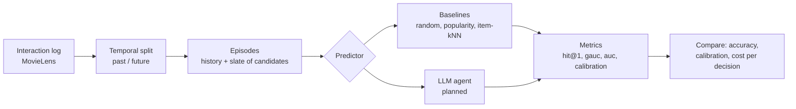

# user-simulation

An experiment in building an LLM agent that simulates a user's decision — e.g. *given
everything this user has done up until now, will they click/watch this movie?* — and
measuring whether it actually predicts real behavior better than classic recommenders.

## Workflow



1. **Load** a real interaction log (who watched what, and when).
2. **Split** it at a point in time: the past is what the simulator may learn from, the
   future is what it has to predict.
3. **Build episodes**: each future interaction becomes a decision — the user's history up
   to that moment plus a slate of movies, one of which they actually chose.
4. **Predict**: every simulator scores the same slates through one shared interface, from
   simple baselines to the LLM agent.
5. **Score** the predictions against what users really did, and compare simulators on
   accuracy, calibration and cost.

## Framing

Every simulator answers the same question on the same **episodes**:

- A global time **cutoff** splits the log. Global statistics (popularity, item
  similarity) are learned only from interactions before it.
- Each post-cutoff interaction becomes an episode: the user is shown a **slate** of
  candidates, one of which they actually chose, plus sampled negatives.
- The simulator sees the user's own history strictly before the episode, then scores
  every candidate.

Negatives are sampled only from items that already existed at decision time and that the
user never rated. `popularity` negatives (default) are drawn proportional to train
popularity, which stops "just pick the blockbuster" from looking like personalization.

Metrics: `hit@1` (did the top pick match the real choice), `mrr`, `ndcg`, `gauc`
(per-slate AUC), pooled `auc`; plus `log_loss` and `ece` for predictors that output
probabilities. Ties count as their random-ordering expectation, so constant scores give
chance-level numbers.

## Usage

```bash
uv sync
uv run user-sim eval                                    # validation split: ml-1m, slate of 5, popularity negatives
uv run user-sim eval --split test                       # test split: only for reporting final numbers
uv run user-sim eval --negatives uniform --slate-size 10
uv run pytest
```

Datasets download to `data/raw/` on first use (git-ignored).

## Baselines (ml-1m test split, default settings, seed 0)

4,874 episodes from 1,044 users; cutoff 2000-12-02.

| negatives  | predictor  | hit@1 | gauc  | auc   |
|------------|------------|-------|-------|-------|
| popularity | random     | 0.201 | 0.500 | 0.499 |
| popularity | popularity | 0.293 | 0.565 | 0.564 |
| popularity | item_knn   | 0.252 | 0.512 | 0.499 |
| uniform    | random     | 0.199 | 0.498 | 0.498 |
| uniform    | popularity | 0.620 | 0.835 | 0.832 |
| uniform    | item_knn   | 0.530 | 0.785 | 0.755 |

Observations so far:

- Recency dominates: the median gap between an episode and the user's previous
  interaction is 0 days. Item-kNN over the last 10 items beats the same model over the
  last 100 (hit@1 0.298 vs 0.252). That's a context-engineering result before any LLM
  is involved: more history is not more signal.
- `ml-latest-small` yields only ~130 episodes under a global cutoff (most users rate in
  a single burst), so it's for smoke tests only.

## Caveats

- MovieLens records *ratings*, not impressions. "Rated" stands in for "watched", and
  "never rated" stands in for "shown but skipped". Ratings also arrive in bulk sessions.
- Hyper-parameters must be chosen on the validation split (`--split validation`, the
  default), not on these episodes. Validation reruns the same split on the log before the
  test cutoff, with the last 14 days as its future: cutoff 2000-11-18, 656 episodes from
  174 users.

## Layout

```
src/user_simulation/
  data/        MovieLens loader, temporal split, episode + negative sampling
  baselines/   random, popularity, item-kNN
  eval/        metrics and the evaluate() runner
  predictor.py the Predictor protocol every simulator (incl. the LLM agent) implements
```
