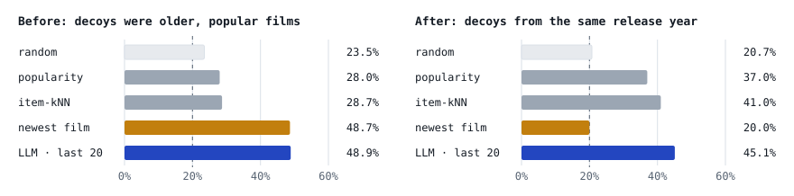
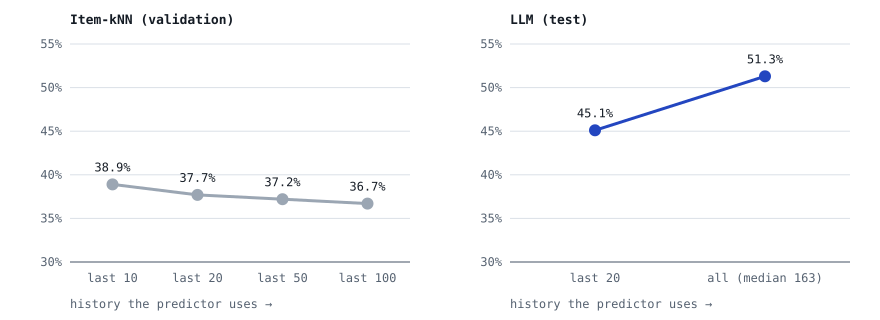
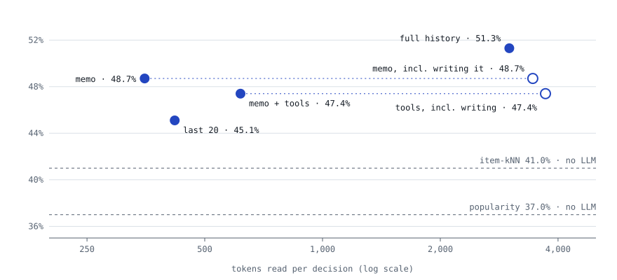
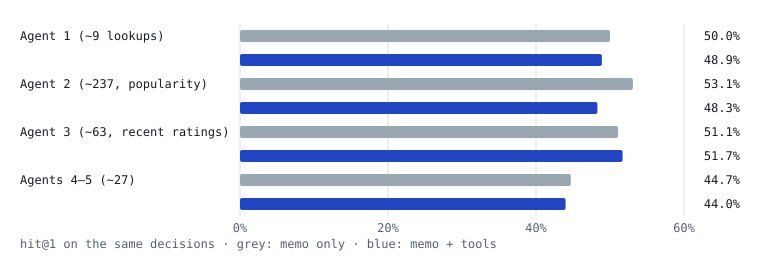

# Can an LLM predict the next movie you'll rate?

We showed Claude a person's movie ratings and five films, and asked which one they rated
next. Then we checked its answers against what 300 real people actually did, and against
classic recommenders.

*Data: [MovieLens 1M](https://grouplens.org/datasets/movielens/1m/) (1,000,209 ratings
from 6,040 people) · 300 test decisions · 4 ways to describe a user · October 2026*

The story is told in plain language. Paragraphs marked **For technical readers** give the
exact method; you can skip them without losing the thread.

## In one minute

1. **Our first test was broken, and the LLM exposed it.** A one-line rule, "pick the
   newest film", matched the LLM's score. We rebuilt the test so that rule scores no better
   than chance.
2. **On the fair test, the LLM beats classic recommenders.** It picks the right film
   45–51% of the time, against 37% for "pick the most popular" and 41% for a standard
   recommender. Guessing scores 20%.
3. **More history helps the LLM.** Reading a person's whole history beats reading their
   last 20 ratings. The classic recommender gets worse with more history.
4. **A 120-word profile keeps most of that gain** at about an eighth of the reading cost
   per decision. Giving the LLM lookup tools added nothing.
5. **A small model trained for the job catches up with the classic recommender, not the
   LLM.** Off the shelf it guesses at chance. After training on 5,940 earlier decisions it
   picks the right film 42% of the time, in a tenth of a second, with the best-calibrated
   probabilities of any predictor.

## The question: a shelf of five films

Picture a video-store shelf with five films on it. One of them is the film this person
really did watch and rate next. The other four are films they never rated. The predictor
sees everything the person rated before that moment, and nothing after. Its job is to say
how likely each film is to be the real one.

This is a small, checkable version of a bigger idea: an AI that can stand in for a real
user. If it can't guess what someone picks off a five-film shelf, it shouldn't be trusted
to simulate them anywhere else.

We compared four simple predictors against the LLM:

- **Random** guesses.
- **Popularity** picks the film that the most people had rated.
- **Item-kNN** is a classic recommender. It picks the film that tends to be rated by the
  same people who rated this person's recent films.
- **Newest film** just picks the most recent release. It turned out to matter a lot.

**For technical readers.** A global cutoff (2 Dec 2000) splits the log. Everything before
it is training data, and every rating after it by a returning user becomes an *episode*:
the user's history strictly before that timestamp plus a shuffled slate of 1 positive and
4 sampled negatives. The test split has 4,874 episodes from 1,044 users. The LLM was
scored on a fixed random subset of 300, with one episode per user. All predictors share
one interface, `score(episode, history)`, and are scored on the same slates.

## How a guess is graded

With five films on the shelf, a blind guess is right one time in five, so **20% is the
floor**.

| measure | question it answers |
|---|---|
| **hit@1** | Was the top pick the film the person really rated? The headline number. |
| **gauc** | Was the real film ranked above the others? Partial credit: second out of five beats last. 0.5 is chance, 1.0 is perfect. |
| **calibration (ece)** | When the model says "30% likely", is it right about 30% of the time? Lower is better. |
| **tokens** | How much text the LLM reads per decision, roughly ¾ of a word per token. This is what an LLM costs to run. |

**For technical readers.** Ties count at their expected value, so constant scores land
exactly at chance. Every hit@1 and gauc comes with a 95% interval from a bootstrap that
resamples *users* (2,000 resamples), and comparisons between predictors are paired on the
same episodes. Calibration is expected calibration error over all candidate
probabilities. Tokens are estimated as characters ÷ 4, including any tool output, because
no API usage was metered.

## One decision, every approach

To show what each approach actually reads and returns, here is one real test decision run
through all of them. Everything below is the real input and output, copied from the run.

**The person.** User 1121 rated 123 films in one sitting on 22 November 2000, then came
back on 1 June 2001. The question is which film they rated next.

**The shelf.** All five films came out in 2000. Their order is shuffled, so the letter
says nothing.

| | film | genres |
|---|---|---|
| A | Scream 3 | Horror, Mystery, Thriller |
| B | Loser | Comedy, Romance |
| C | Hollow Man | Horror, Sci-Fi, Thriller |
| D | **U-571** ← actually rated next | Action, Thriller |
| E | X-Men | Action, Sci-Fi |

### Classic predictors

These read the history as numbers and give each film a score. The highest score is the
pick.

| predictor | what the score is | A | B | C | D | E | top pick |
|---|---|---:|---:|---:|---:|---:|---|
| random | a random number | 0.64 | 0.27 | 0.04 | 0.02 | 0.81 | E · X-Men |
| popularity | people who rated it before the cutoff | 464 | 76 | 225 | 657 | 1,069 | E · X-Men |
| newest film | release year | 2000 | 2000 | 2000 | 2000 | 2000 | five-way tie |
| item-kNN | similarity to the person's last 10 films | 1.28 | 0.42 | 0.97 | 1.53 | 1.97 | E · X-Men |

All of them miss. X-Men is the more popular film, and it is also closer to what similar
viewers rated. The newest-film rule has nothing to go on, because every film on the shelf
is from 2000.

### LLM · last 20 ratings

**Input** (~414 tokens). Every LLM approach gets the same instructions, with one phrase
changed to say what it is shown:

```text
You are simulating one MovieLens user at a moment in time. You see their most recent
ratings (1-5 stars) and a slate of candidate movies. Exactly one candidate is the movie
this user actually rated next; the others are movies they never rated. For every
candidate give the probability that it is the one they picked; probabilities sum to 1.
Answer with a JSON object mapping each candidate letter to its probability.
```

Then the person and the shelf:

<details>
<summary>Show the full prompt (20 ratings)</summary>

```text
Today is 2001-06-01. The user's last 20 ratings, oldest first:
- Witness (1985) | Drama, Romance, Thriller | 5
- Doctor Zhivago (1965) | Drama, Romance, War | 5
- When Harry Met Sally... (1989) | Comedy, Romance | 5
- Some Folks Call It a Sling Blade (1993) | Drama, Thriller | 5
- Manchurian Candidate, The (1962) | Film-Noir, Thriller | 4
- Crimson Tide (1995) | Drama, Thriller, War | 4
- Three Days of the Condor (1975) | Thriller | 5
- Love Letter, The (1999) | Comedy, Romance | 4
- Big Chill, The (1983) | Comedy, Drama | 5
- Player, The (1992) | Comedy, Drama | 3
- Ruling Class, The (1972) | Comedy | 4
- Moonstruck (1987) | Comedy | 5
- Father of the Bride (1950) | Comedy | 4
- Alien (1979) | Action, Horror, Sci-Fi, Thriller | 2
- Blues Brothers, The (1980) | Action, Comedy, Musical | 4
- Thelma & Louise (1991) | Action, Drama | 5
- In the Line of Fire (1993) | Action, Thriller | 4
- Hoop Dreams (1994) | Documentary | 4
- When We Were Kings (1996) | Documentary | 5
- Buena Vista Social Club (1999) | Documentary | 5
Candidates:
A. Scream 3 (2000) | Horror, Mystery, Thriller
B. Loser (2000) | Comedy, Romance
C. Hollow Man (2000) | Horror, Sci-Fi, Thriller
D. U-571 (2000) | Action, Thriller
E. X-Men (2000) | Action, Sci-Fi
```

</details>

**Output:**

```json
{"A": 0.15, "B": 0.12, "C": 0.13, "D": 0.25, "E": 0.35}
```

It leans toward X-Men (35%), with U-571 second (25%). The last 20 ratings show some
thrillers and action, but nothing that separates a war thriller from a superhero film.

### LLM · full history

**Input** (~1,726 tokens). The same instructions, saying "their full rating history"
instead of "their most recent ratings". Then all 123 ratings and the same shelf:

```text
Today is 2001-06-01. The user's 123 ratings so far, oldest first:
- Breakfast at Tiffany's (1961) | Drama, Romance | 4
- Shining, The (1980) | Horror | 1
- Back to the Future (1985) | Comedy, Sci-Fi | 3
- Basic Instinct (1992) | Mystery, Thriller | 4
- One Flew Over the Cuckoo's Nest (1975) | Drama | 5
  … 114 more ratings …
- In the Line of Fire (1993) | Action, Thriller | 4
- Hoop Dreams (1994) | Documentary | 4
- When We Were Kings (1996) | Documentary | 5
- Buena Vista Social Club (1999) | Documentary | 5
Candidates:
A. Scream 3 (2000) | Horror, Mystery, Thriller
  … same five candidates …
```

**Output:**

```json
{"A": 0.07, "B": 0.08, "C": 0.1, "D": 0.45, "E": 0.3}
```

Now U-571 leads with 45%. The full history shows five-star war films and Tom Clancy
thrillers (The Hunt for Red October), and low ratings for sci-fi and horror (The
Shining: 1 star, Alien: 2).

### LLM · memo

Two steps, possibly done at different times.

**Step 1, write the memo** (~1,841 tokens, done once per person). The writer gets the
same 123 ratings, but **not** the shelf, with these instructions:

```text
Write a profile of this MovieLens user from their rating history (1-5 stars), for someone
who will later have to predict which movie they rate next without seeing the history.
At most 120 words: tastes and dislikes (genres, eras, tone, franchises), rating habits,
and what they have been rating most recently. Answer with the profile text only.
```

It wrote this memo (119 words):

> Adult, classic-leaning viewer with conventional prestige taste who rates generously
> (many 5s). Loves classic and war drama (Lawrence of Arabia, Bridge on the River Kwai, Das
> Boot, 12 Angry Men, To Kill a Mockingbird, Hamlet 1948), crime (Godfather I-II, Fargo,
> Body Heat, Bonnie and Clyde, Chinatown), romantic classics (Doctor Zhivago, When Harry Met
> Sally, Witness, African Queen), Clancy thrillers (Hunt for Red October 5) and comic
> classics (The Sting, Bull Durham, Harold and Maude). Dislikes sci-fi and horror (The
> Shining 1; Aliens, Alien, Men in Black 2), is cool on Bond (Goldfinger 2) and Batman (2),
> and disliked Sense and Sensibility (2). Most recent ratings are documentaries (When We
> Were Kings, Buena Vista Social Club 5; Hoop Dreams 4).

**Step 2, decide** (~361 tokens). The same instructions, saying "a short profile of the
user", then:

```text
Today is 2001-06-01. Profile of the user:
Adult, classic-leaning viewer with conventional prestige taste … (the memo above)
Candidates:
A. Scream 3 (2000) | Horror, Mystery, Thriller
  … same five candidates …
```

**Output:**

```json
{"A": 0.07, "B": 0.08, "C": 0.07, "D": 0.5, "E": 0.28}
```

U-571 at 50%, the most confident of any approach. The memo spells out exactly the two
facts that matter here: war films and Clancy thrillers are favourites, while sci-fi is
disliked.

### LLM · memo + tools

**Input** (~548 tokens before any lookups). The memo prompt, plus the episode id and this
addition to the instructions:

```text
Before answering you can look things up, from the repository root, with
  uv run python -m user_simulation.tools data/llm/test-matched-memo-tools <episode id> <tool> [arg]
where <tool> is one of:
  recent_history N      the user's last N ratings (N <= 50), with dates
  similar_in_history X  the 5 movies in the user's history most often co-rated with
                        candidate X by other users, with the user's own ratings
  item_details X        candidate X's genres, year, and how many people rated it before
                        the cutoff, with their mean rating
  history_stats         totals: number of ratings, mean rating, top genres and decades
Use as many or as few lookups as you find useful.
```

For this decision the agent made **no lookups** and answered from the memo alone. Here
is what the tools would have returned, for illustration:

<details>
<summary>Show example lookups for this person</summary>

```text
$ history_stats
123 ratings from 2000-11-22 to 2000-11-22, mean 4.07.
Top genres: Drama 52 (mean 4.3), Action 39 (mean 3.8), Thriller 38 (mean 3.9), Comedy 33 (mean 4.2), Crime 27 (mean 4.0), Mystery 20 (mean 4.0).
Decades: 1930s 1, 1940s 4, 1950s 7, 1960s 13, 1970s 12, 1980s 21, 1990s 65.

$ item_details D
U-571 (2000) | Action, Thriller | rated by 657 people before the cutoff, mean rating 3.56

$ item_details E
X-Men (2000) | Action, Sci-Fi | rated by 1069 people before the cutoff, mean rating 3.88

$ similar_in_history D
Men in Black (1997) | user rated 2 | similarity 0.358
Jurassic Park (1993) | user rated 3 | similarity 0.348
Braveheart (1995) | user rated 4 | similarity 0.341
Saving Private Ryan (1998) | user rated 5 | similarity 0.328
American Beauty (1999) | user rated 5 | similarity 0.318
```

</details>

**Output:**

```json
{"A": 0.13, "B": 0.17, "C": 0.15, "D": 0.35, "E": 0.2}
```

U-571 again, but at 35% rather than 50%. The memo is identical, so the difference comes
from a different agent answering. This is the agent-to-agent noise described under
[How sure are we?](#how-sure-are-we). The `item_details` lookups show why popularity
counts can mislead: they would have favoured X-Men, rated by 1,069 people against 657.

### Side by side

| approach | tokens read for this decision | top pick | chance given to U-571 |
|---|---:|---|---:|
| random | – | X-Men ✗ | – |
| popularity | – | X-Men ✗ | – |
| newest film | – | tie | 20% |
| item-kNN | – | X-Men ✗ | – |
| LLM · last 20 | ~414 | X-Men ✗ | 25% |
| LLM · full history | ~1,726 | **U-571 ✓** | 45% |
| LLM · memo | ~361 (+ ~1,841 once to write the memo) | **U-571 ✓** | **50%** |
| LLM · memo + tools | ~548 | **U-571 ✓** | 35% |

We picked this decision because it shows the approaches disagreeing. It is not typical
in size: across all 300 decisions, full history adds about 6 points over the last 20
ratings. Token counts are characters ÷ 4.

## First, the test fooled us

Our first run looked like a big win: the LLM picked the right film 49% of the time, far
ahead of popularity at 28%. But one of our checks, "always pick the newest film", scored
49% too. A rule with no knowledge of the person was matching the LLM.

The cause was in how we filled the shelf. The four decoy films were chosen by how popular
they had been *before* the cutoff, so they were almost always older films. The real pick,
though, was often a new release: people coming back to the site tend to rate what just
came out. The shelf gave the answer away: the newest film was usually the real one.

So we rebuilt the shelf. Decoys now come from **the same release year** as the real
film, chosen in proportion to how much they were being rated at that moment. "Newest
film" drops to exactly chance, and every number from here on uses the fixed test.



*The LLM here reads the last 20 ratings in both panels. Before the fix, its lead over
popularity and kNN was almost entirely the release-date giveaway (amber). After the fix,
that rule falls to chance while the LLM keeps a real lead. The before panel covers 293
test users and the after panel 300.*

**For technical readers.** On validation, 45% of real choices were 1999–2000 films,
against 14% of popularity-weighted negatives. A first fix, weighting negatives by the
last 100,000 ratings, still let `newest_release` reach 0.424 hit@1 on validation. Exact
release-year matching, with the year band widening only when fewer than 4 candidates
exist, brought it to 0.200. The choice of negatives can matter more than the model: with
uniformly sampled negatives, plain popularity scores 0.620.

## On a fair test, the LLM wins

We gave the LLM four ways of seeing the person:

- their **last 20** ratings;
- their **full history**, a median of 163 ratings;
- a short **memo** written beforehand from that history;
- the **memo plus lookup tools** it could use to check details.

Each version answered the same 300 decisions. Every version scores above every classic
predictor. Reading the full history does best, with the right film on top 51% of the
time. The green bar is the small trained model from
[A small model trained for the job](#a-small-model-trained-for-the-job).


| predictor | hit@1 | gauc | log loss | ece | tokens / decision | incl. writing memo |
|---|---:|---:|---:|---:|---:|---:|
| random | 0.207 | 0.488 | | | | |
| newest film | 0.200 | 0.500 | | | | |
| popularity | 0.370 | 0.629 | | | | |
| item-kNN | 0.410 | 0.652 | | | | |
| LLM · last 20 | 0.451 | 0.706 | 0.454 | 0.052 | ~419 | |
| LLM · full history | **0.513** | **0.758** | 0.425 | 0.061 | ~3,002 | |
| LLM · memo | 0.487 | 0.738 | **0.423** | **0.046** | **~351** | ~3,448 |
| LLM · memo + tools | 0.474 | 0.737 | 0.440 | 0.060 | ~617 | ~3,714 |

**For technical readers.** A constant 0.2 per candidate scores log loss 0.500, so every
LLM context carries real probabilistic signal. All four LLM runs returned 300 of 300
parseable answers. The validation split (last 14 days before the test cutoff: 656
episodes, 174 users) was used for every tuning choice. Nothing was tuned on test.

## More history: noise for kNN, signal for the LLM

People on MovieLens rate in bursts: at least half the time, a rating comes the same day
as their previous one. For the classic recommender, the latest few films are the useful
part, and older ratings only dilute them. It works best on the last 10 films and gets
worse with every extra slice.

The LLM behaves the other way around. Given everything, it picks up long-running tastes,
like the war-film fan in [One decision, every approach](#one-decision-every-approach), that a recent burst hides.



*Both panels share one scale. The kNN values come from the validation split, where we
tuned how many recent films it uses; the LLM values come from the test split.*

## A 120-word memo does most of the work

Reading a full history costs about 3,000 tokens per decision, seven times the last-20
version. So we tried a shortcut: one pass over the history writes a short profile, up to
120 words, covering tastes, dislikes, rating habits and what the person has watched
lately. The decision is then made from the profile alone.

The memo recovers about 60% of the gap between "last 20" and "full history", at the
lowest cost per decision of any version, and its probabilities are the most honest (best
calibration). The catch is that writing the memo still means reading the whole history
once. It saves money only when one memo serves many decisions about the same person. In
this test each person had one decision, so the total cost was no lower.



*Solid dots are the cost at decision time. Hollow dots add the one-off cost of writing
the memo; with many decisions per person that cost is spread thin, and the dot slides
left toward the solid one.*

## Lookup tools didn't help

The last version got the memo plus four tools. It could pull the person's recent
ratings, find films in their history related to a candidate, check how many people had
rated a candidate, or get summary stats. It came out slightly behind the memo alone
(47.4% vs 48.7%, within noise) while reading nearly twice as much.

How the tools were used mattered more than having them. Each batch was answered by a
separate agent, and their habits differed a lot. The agent that mostly checked how many
people had rated each film did worst. That cue misleads here, because the decoys are
already picked in proportion to how much they were being rated. The agent that checked
recent ratings for every person roughly tied with the memo.



*Each pair is the same people, answered once from the memo alone and once with tools.
Lookup counts are as reported by each agent; 335 calls were logged in all (233 popularity
and genre lookups, 95 recent-rating lookups, 7 related-film lookups). Groups of 60 are
small, so read the direction, not the exact gaps.*

## A small model trained for the job

An LLM is a general-purpose reader that writes out its answer. We also tried the opposite
kind of model. [Laya](https://huggingface.co/convaiinnovations/laya) is a small decision
model: it reads the same description of the person and the shelf, then scores the five
films in a single pass, without writing any text. It runs on one GPU, with no API.

Off the shelf, it is no better than guessing (18–20%). So we trained it on the task:
5,940 earlier decisions, each one a person's history and a shelf, all taken from before
the validation period, so no test decision was ever trained on. Trained, it picks the
right film 42% of the time: level with the classic recommender, below every LLM version.

| predictor | hit@1 | gauc | log loss | ece | Laya tokens / decision | seconds / decision |
|---|---:|---:|---:|---:|---:|---:|
| Laya off the shelf · last 20 | 0.197 | 0.509 | 0.536 | 0.083 | ~546 | 0.04 |
| Laya off the shelf · full history | 0.183 | 0.500 | 0.530 | 0.066 | ~993 | 0.10 |
| Laya trained · last 20 | 0.390 | 0.673 | 0.463 | **0.031** | ~546 | **0.04** |
| Laya trained · full history | **0.417** | **0.681** | 0.463 | 0.035 | ~993 | 0.10 |

*For comparison, on the same 300 decisions: popularity 0.370, item-kNN 0.410, LLM
· last 20 0.451, LLM · full history 0.513.*

Three things stand out:

- **Training is what makes it work.** It goes from chance to the classic recommender's
  level. Its ranking (gauc 0.681) is better than kNN's (0.652), but against popularity
  the difference is still within noise: +4.7 points, interval [−3.0, +11.7].
- **Its probabilities are the most honest of any predictor.** Calibration error is 0.031,
  against 0.046 for the best LLM version. Training ends by fitting how confident the
  model should be, on 400 decisions it was not trained on.
- **"Full history" is mostly a cut-down history.** Laya reads at most about 1,000 tokens,
  so 270 of the 300 full histories were trimmed to fit. Full still edges out the last 20
  ratings (41.7% vs 39.0%), but that gap is within noise.

**For technical readers.** The model is the `multilingual` checkpoint, fine-tuned with
`laya-train` defaults: 4 epochs, RLCD loss (a policy-gradient term plus soft
cross-entropy), effective batch 64, 372 optimizer updates, candidate order shuffled every
time a row is seen. Training rows come from 14-day windows before the validation cutoff
(2000-11-18), with the full-history context. On all 656 validation episodes, accuracy
rose from 0.212 to 0.360 and cross-entropy fell from 1.691 to 1.546. A temperature of
1.61 was fitted on 400 held-out training rows. Nothing was tuned yet: one seed, default
epochs. Training loss was still falling at epoch 4 (1.40, 1.31, 1.21, 1.10 per epoch), so
more epochs may help, to be chosen on validation. Laya's token counts come from its own
tokenizer, so they don't compare directly with the LLM's characters ÷ 4. Times are on a
Colab GPU.

## How sure are we?

300 decisions is enough to separate big effects from noise, but not small ones. For each
comparison we compared both predictors on the same decisions and asked whether the
plausible range of the difference excludes zero.

| comparison (hit@1) | difference [95% interval] | verdict |
|---|---|---|
| LLM (last 20) vs popularity | +8.1 pts [+2.3, +13.7] | clear win |
| Full history vs last 20 | +6.3 pts [+2.2, +10.6] | clear win |
| LLM (last 20) vs item-kNN | +4.1 pts [−1.4, +9.4] | likely (clear on ranking) |
| Memo vs last 20 | +3.7 pts [−0.6, +7.9] | likely (clear on ranking) |
| Full history vs memo | +2.6 pts [−1.4, +6.8] | can't tell |
| Memo + tools vs memo | −1.3 pts [−4.6, +1.9] | no difference |
| Laya trained (full) vs popularity | +4.7 pts [−3.0, +11.7] | can't tell |

One more source of noise: each version was answered by a different set of AI agents. On
the same 60 decisions, two agents can differ by about 5 points, as large as some of the
gaps above. The clear wins hold up. The finer comparisons need more decisions, or the
same agents answering every version.

**For technical readers.** "Clear on ranking" means the paired gauc interval excludes
zero: +0.054 [+0.020, +0.087] for last 20 vs kNN, and +0.033 [+0.006, +0.059] for memo vs
last 20. Intervals come from a cluster bootstrap over users. With n = 300, the standard
error of hit@1 is about ±0.03.

## What this means

- **Test the test first.** A one-line rule that matches your model is a sign the
  benchmark leaks. Run dumb baselines that encode a single shortcut, and expect the model
  to find any shortcut you leave in.
- **LLMs read history differently.** Classic recommenders want the freshest signal. An
  LLM can use a person's long-term taste, so give it more history than you would give kNN.
- **Compress once, reuse often.** A short written profile keeps most of the full-history
  gain and is the best calibrated. It pays off when the same person faces many decisions.
- **Tools need a reason.** Open-ended lookups cost tokens and can pull the model toward
  misleading cues. Add a tool when it answers a question the context can't.
- **A small model needs task data.** Off the shelf, a decision model knew nothing useful
  here. A few thousand past decisions brought it to the classic recommender's level, at a
  tenth of a second per decision and with honest probabilities.

## How the experiment was kept honest

- **No peeking at the future.** Each predictor sees only ratings made before the
  decision. Popularity and similarity statistics come only from before the cutoff.
- **Tuned on validation, reported on test.** Every choice, like how many recent films kNN
  uses (10, chosen from 10, 20, 50 and 100), was made on an earlier 14-day window.
- **One decision per person.** A person's second decision contains their first answer in
  its history. Showing both would leak it, so the 300 decisions come from 300 different
  people.
- **No API, answers cached.** Prompts were exported to files and answered by Claude (Opus
  5.5) subagents inside Claude Code. Each answer is stored under a hash of the exact
  prompt, so changing a prompt can never reuse a stale answer.
- **Fresh agents per version.** The agents saw only their own batch of prompts, never the
  answers, other versions' prompts, or any per-decision results. Memo writers saw the
  history but not the shelf.
- **Training stops before validation.** Laya's training decisions all come from before
  the validation cutoff, so neither validation nor test decisions were trained on.
- **Exclusions.** In the first run, 7 people were dropped because their later prompts had
  been read during an earlier faulty export.

**Limits.** MovieLens records ratings, not views, so "rated" stands in for "watched" and
"never rated" stands in for "shown but skipped". The agents were given rules but not
sandboxed: two reported running several lookup commands in one shell call. Token counts
are estimates (characters ÷ 4) and leave out reasoning and answer tokens. 11 of the 300
memos run slightly over 120 words, the longest at 125. One model family wrote the code,
the memos and the answers. Laya was trained once, with one seed and default settings.

## Run it yourself

```bash
# baselines on the validation split, then on test
uv run user-sim eval
uv run user-sim eval --split test

# export prompts for one context; answer them in responses-NN.json
uv run user-sim llm-export --split test --context full

# score all four contexts next to the baselines
uv run user-sim llm-eval --split test --context recent full memo memo-tools --reference llm_recent

# Laya: export training rows, fine-tune (GPU; see notebooks/laya_finetune.ipynb), score
uv sync --extra laya
uv run user-sim laya-export --context full
uv run laya-train --base multilingual --data data/laya/matched-full/train.jsonl \
    --eval data/laya/matched-full/validation.jsonl --out data/laya/checkpoints/laya-movielens-full \
    --shuffle-options --epochs 4 --device cuda --seed 0
uv run user-sim laya-eval --split test --context recent full \
    --checkpoint multilingual data/laya/checkpoints/laya-movielens-full

# redraw the figures in this report
uv run python docs/figures/make_figures.py
```
